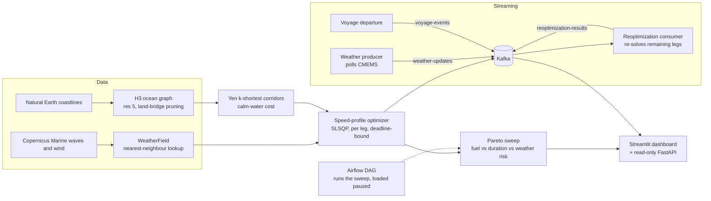

# NAVI-Opt: Maritime Voyage Routing & Reoptimization

A tanker voyage planner for one real route, Rotterdam to Ceyhan, built end to end:
an ocean graph from H3 cells, diverse route corridors, a weather-aware per-leg
speed optimizer, a fuel / duration / weather-risk Pareto analysis, a Kafka layer
that reoptimizes a sailing voyage when the forecast changes, and a Streamlit
dashboard and read-only FastAPI on top.

It is a portfolio project, not a product. The weather is real; the vessel and the
voyage clock are not. [What is real, synthetic and simulated](#what-is-real-synthetic-and-simulated)
is spelled out below, and so is [what has not been verified](#limitations-and-what-is-not-verified).

## How it fits together



Corridors are generated once on static calm-water cost. Weather is then used where
it matters, in the speed optimizer, so a corridor's fuel and per-leg speeds are
re-evaluated against real conditions. A* is deliberately not weather-aware: its
heuristic is only admissible under a weather-independent cost, and `findings.md`
records why that scope was kept.

## What is real, synthetic and simulated

| | What | Source |
|---|---|---|
| **Real** | Coastlines, port positions | Natural Earth |
| **Real** | Wave height and wind fields | Copernicus Marine (CMEMS), a fixed June 2024 window |
| **Synthetic** | Vessel fuel-speed curves (MR2 product tanker) | `config/vessel_profiles.yaml`, set within literature-reported ranges; not a real ship |
| **Synthetic** | Voyage deadlines | Derived from the fastest possible transit plus a margin |
| **Simulated** | Voyage position over time | A demo clock: 1 real minute = 10 simulated voyage hours. Not vessel tracking |
| **Injected** | Weather-change events in the Phase 6 demo | Labelled test events (`injected: true`), because the fixed June 2024 forecast does not revise |

Fuel and time figures are model outputs on synthetic vessel data. They are not
measurements, and nothing here supports a claim about real fuel savings.

## What it found

All numbers are from `findings.md`, which records each phase with its caveats.

- **Real graph:** 386 legs from Rotterdam to Ceyhan at H3 resolution 5, three geometrically diverse corridors.
- **Real weather costs fuel and reshapes speed.** With a deadline 15% above the fastest possible transit, the weather-aware solve burns about 11 t (+1.9%) more than the calm-water solve on every corridor. Speeds spread from a flat 13.9 kn to 13.8 to 14.0 kn, slowing on rough legs and speeding up elsewhere to hit the same deadline.
- **Pareto trade-off.** Across 15 swept plans, 5 are non-dominated, and fuel falls from about 749 t at a 229 h transit to about 337 t at 366 h. All 5 frontier plans are on corridor 1. Only 2 of those 5 solves finished with a proven optimum, and 11 of all 15 hit their iteration or time cap, so treat the exact frontier as approximate.
- **Reoptimization on a real Kafka broker.** An injected event on an edge ahead of a sailing voyage triggered a real CMEMS re-fetch and a bounded re-solve of the 240 remaining legs: +3.5 t of fuel and -2.2 h of transit against the previous plan on those same legs. That demonstrates the event pipeline. It does not show the optimizer reacting to a storm, because the injected event does not change the weather the re-solve reads.

### Bugs the checks caught

These are worth reading in `findings.md` because they show the verification, not just the features.

- A* named and documented as calm-water only after its settling logic and heuristic turned out not to support time-dependent cost.
- Three bugs in Yen's algorithm found before shipping, with regression tests proven to fail when each bug is reintroduced.
- A numerical-noise issue in the Pareto dominance check that let a clearly worse corridor survive the frontier.
- A before/after print comparing a whole voyage against only its remaining legs, which looked like a 36% saving and was nothing of the kind. Both the dashboard and the API now compare like for like and say so in the payload (`basis: "remaining_legs"`).
- An invalid Kafka cluster ID that crash-looped the broker, and an unbounded solve that ran for tens of minutes. Reoptimization and departure solves are now capped at 60 iterations and 180 s.

## Quickstart

Requires Anaconda, Docker Desktop and a free [Copernicus Marine account](https://data.marine.copernicus.eu/register). Commands below are for Windows Anaconda Prompt.

```
conda env create -f environment.yml
conda activate m01-navi-opt
copy .env.example .env
```

Edit `.env` with your Copernicus credentials. It is gitignored; never commit it.
Docker Compose reads it directly, so create it before the next step.

**1. Infrastructure** (Kafka in KRaft mode, Kafka UI, Airflow, Postgres):

```
cd infra
docker compose up -d --build
cd ..
```

Kafka UI is at http://localhost:8081 and Airflow at http://localhost:8080. The
`pareto_sweep_rotterdam_ceyhan` DAG loads paused; read its docstring before enabling it (about 45 minutes, real CMEMS calls).

**2. Build the ocean graph and the Pareto sweep** (both write to `data/processed/`, which is gitignored):

```
python scripts/build_real_ocean_graph.py
python scripts/run_pareto_sweep.py
```

**3. Dashboard and API** (both read the sweep CSV and the Kafka topics):

```
streamlit run src/navi_opt/dashboard/app.py
uvicorn navi_opt.api.app:app --port 8000
```

The API docs are at http://localhost:8000/docs. It is read-only and unauthenticated, so keep it on localhost. Both honour `NAVI_DATA_DIR` and `NAVI_KAFKA`.

**4. Live reoptimization demo** (each in its own terminal):

```
python scripts/run_reoptimization_consumer.py
python scripts/depart_demo_voyage.py
python scripts/inject_weather_event.py
```

Start the consumer first, depart a voyage (the solve takes a few minutes), then inject a labelled event on an edge still ahead of it. `scripts/run_weather_producer.py` polls CMEMS for genuine forecast changes, but the fixed June 2024 window rarely revises. If topics are missing, create `voyage-events`, `weather-updates` and `reoptimization-results` first.

Run the tests with `pytest -q tests`. Run them from the repo root: pytest started inside `infra/` trips over Airflow's log symlinks on Windows.

## Repository layout

```
config/                  vessel fuel-curve profiles, ports
data/{raw,processed}/    Natural Earth, CMEMS pulls, cached graph and sweep (gitignored)
src/navi_opt/
  grid/                  H3 ocean cells, land masking, graph building and routing adapter
  weather/               CMEMS client, WeatherField lookup, resistance and fuel model
  routing/               calm-water A*, Yen's k-shortest paths with corridor diversity
  optimization/          SLSQP speed-profile optimizer, epsilon-constraint Pareto sweep
  orchestration/         Airflow task logic for the sweep
  streaming/             voyage registry, reoptimizer, Kafka producer and consumer logic
  dashboard/             Streamlit app, tested data layer and Plotly chart builders
  api/                   read-only FastAPI over the same data layer
infra/                   docker-compose (Kafka, Kafka UI, Airflow, Postgres), Airflow image and DAG
scripts/                 graph build, sweep, demo voyage, producer, consumer, event injector
tests/                   249 tests; broker-facing code is tested through injected fakes
findings.md              the running log: decisions, results, bugs, and what is unverified
```

## Limitations and what is not verified

- **Synthetic vessel.** Fuel curves are plausible, not measured, so absolute tonnages mean nothing for a real ship. The shape of the trade-offs is the point.
- **One route, one weather window.** Rotterdam to Ceyhan in June 2024 only. The Pareto numbers are not a general result.
- **Optimality is not proven for most solves.** Bounded SLSQP with finite-difference gradients. 11 of the 15 swept plans stopped at their cap, and the demo voyage's original plan misses its own deadline by about 1.3 h.
- **Severe-weather hours are empty in the checked-in sweep.** That column was added after the sweep ran; filling it needs a rerun of about 45 minutes.
- **The storm response is not demonstrated.** The reoptimization pipeline works end to end, but the injected event does not change the weather the re-solve reads, so the small fuel change is a re-solve, not a reaction to a storm.
- **Not observed:** the consumer rejoining its group after a poll-limit drop, and the weather producer publishing a genuine (not injected) event.
- **Airflow:** the DAG has not been run on a schedule, only built and loaded paused.
- **No ECA routing constraints.** The config holds an ECA fuel-price premium, but nothing in the router or optimizer enforces ECA zones.
- **No authentication or multi-user state.** The consumer's voyage registry is in memory, and the API is a localhost demo.
